

  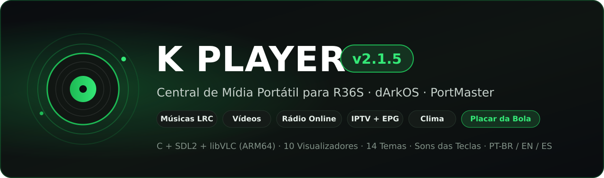

<h1 align="center">KPlayer v2.0.2</h1>

  <strong>Portable media center for R36S (dArkOS / PortMaster)</strong> 
  Music with synced lyrics (.LRC) · Video · Online Radio · IPTV · <strong>Placar da Bola (Live Football)</strong>

  <a href="README.pt-BR.md">Português (BR)</a> ·
  <a href="docs/INSTALL.md">Installation</a> ·
  <a href="docs/CONTROLS.md">Controls</a> ·
  <a href="docs/MEDIA.md">Media &amp; Lyrics</a> ·
  <a href="TERMS.md">Terms &amp; Transparency</a> ·
  <a href="CHANGELOG.md">Changelog</a> ·
  <a href="releases/RELEASE_NOTES.md">v2.0.2 Release Notes</a> ·
  <a href="THIRD_PARTY.md">Licenses</a>

---

## What's New in v2.0.2

- **In-App Transparency Notice & Updated Terms:** Before entering **Online Radio** or **IPTV**, KPlayer shows a clear transparency screen explaining that all listings come from public internet aggregators or open sources, that KPlayer hosts no content, and that you always have the right to add your own links and playlists.
- **Animated Boot Splash Screen:** Every launch displays an animated boot splash featuring a spinning vinyl disc, expanding sonar rings, orbiting sparks, a 28-bar live equalizer, and a shimmering progress bar that preloads your library, radio, IPTV, and live football scores upfront — making in-app navigation instant.
- **Slim Animated Welcome Screen:** Redesigned first-run experience matching the boot aesthetic with a compact unified language capsule (**PT-BR / English / Español**) and **7 live color theme dots** — removing bulky cards and bottom-bar clutter.
- **Placar da Bola (SofaScore-style Match Center):** Live, finished, and upcoming football scores across **Brasileirão, Libertadores, UEFA Champions League, Premier League** and more, with filters (`All`, `Live`, `Brazil`, `Europe`) and a full match detail view with **Comparison Stats**, **Minute-by-Minute Events**, and **Lineups**.
- **Refined Music Player:** Re-centered, symmetric transport bar (previous / play-pause / next + aligned progress bar) with sharper geometric icons, embedded artwork/vinyl, technical audio specs, and switchable **Synced Lyrics (.LRC)**, **Queue**, and **Folder** panes.
- **Dedicated Media Folders (Fast Boot, Zero SD Overhead):** No more scanning the entire SD card (ROMs/BIOS/saves are skipped). KPlayer indexes exclusively:
  - **Music:** `/roms/bgmusic` (SD1) and `/roms2/bgmusic` (SD2)
  - **Videos:** `/roms/videos` (SD1) and `/roms2/videos` (SD2)
- **Unlocked Category-by-Category IPTV (Canais · Filmes · Séries · User IPTV):** Zero item limits with lazy on-demand category loading — **245 TV Channels** across 12 categories (`catalogo.txt` + reserves from `https://canais-saimo.pages.dev/`), **Filmes** (~30,000+ movies by highlights, anime/kids, TMDB genres, and A–Z), **Séries** (~13,000+ series with full seasons and all episodes from `https://filmes-saimo.pages.dev/`), and **User IPTV** (built-in virtual keyboard for `.m3u`/`.m3u8` URLs plus automatic scanning of `ports/kplayer/iptv_usuario/`).
- **dArkOS / EmulationStation Port Artwork & XML Metadata:** `KPlayer-v2.0.2-R36S.zip` ships with a custom 640×480 cover (`images/KPlayer-image.png`), ready-to-use `gamelist.xml`, and a standalone `kplayer/KPlayer-metadata.xml` snippet to merge with existing ports.

---

## Screenshots (640 × 480 — R36S)

| Animated Boot Splash | Slim Welcome (Language + Theme Dots) |
| :---: | :---: |
| 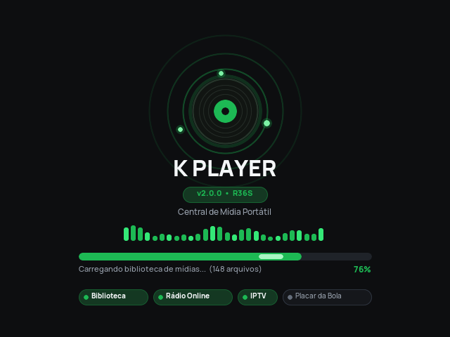 | 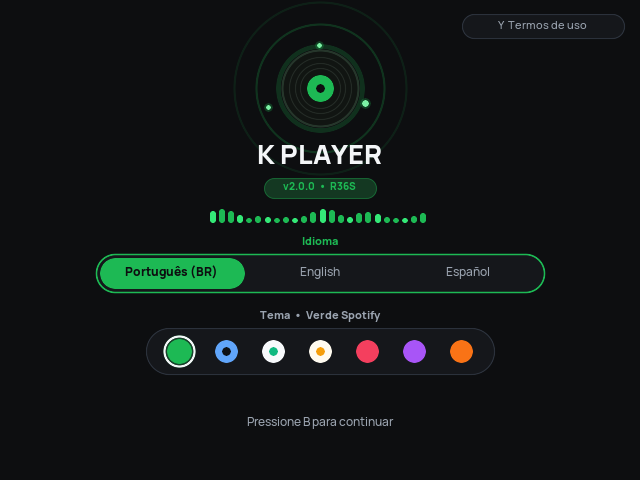 |
| **Main Dashboard** | **Music Player & Synced Lyrics (.LRC)** |
| 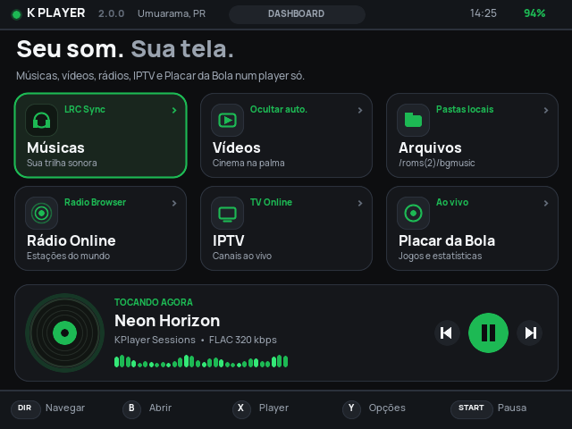 | 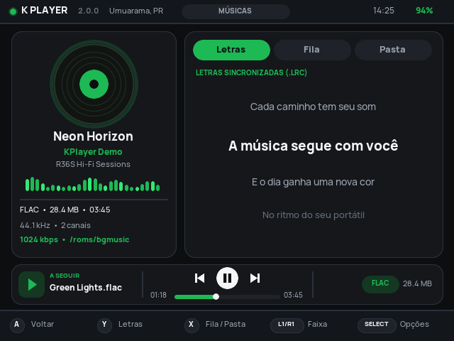 |
| **Placar da Bola — Live Matches** | **Placar da Bola — Match Statistics** |
| 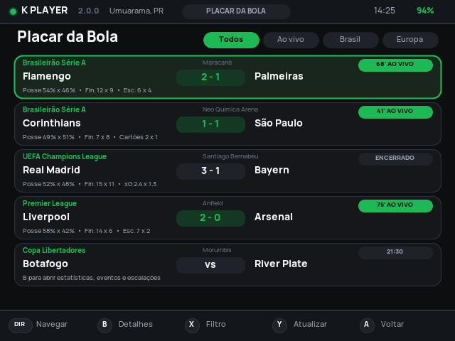 | 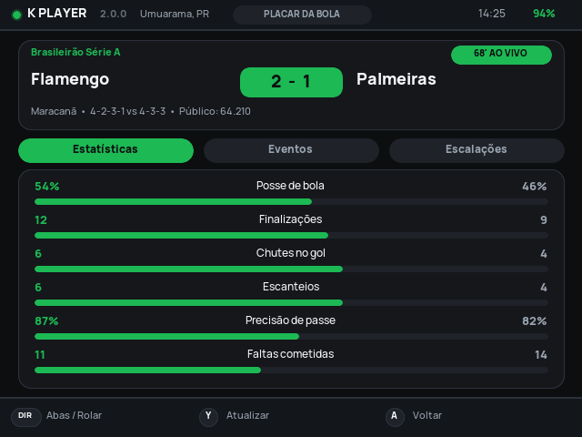 |
| **Online Radio** | **IPTV (Canais · Filmes · Séries · User)** |
| 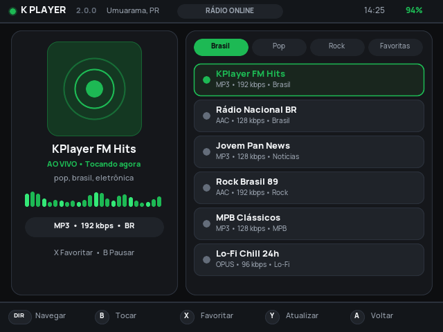 | 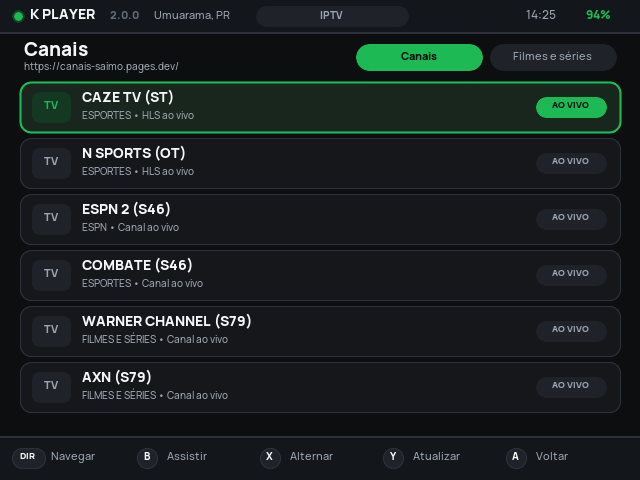 |
| **Dedicated Folders (SD1 / SD2)** | **Video Player (libVLC)** |
| 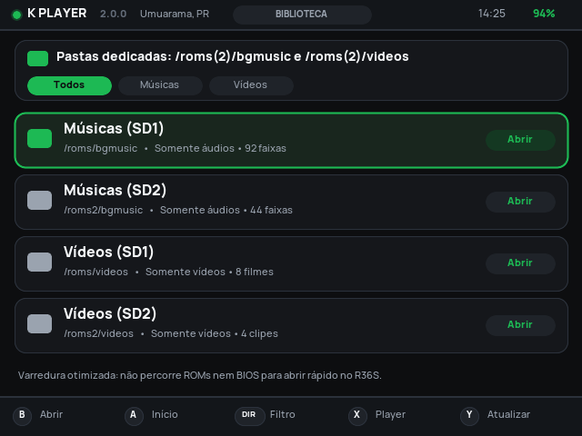 | 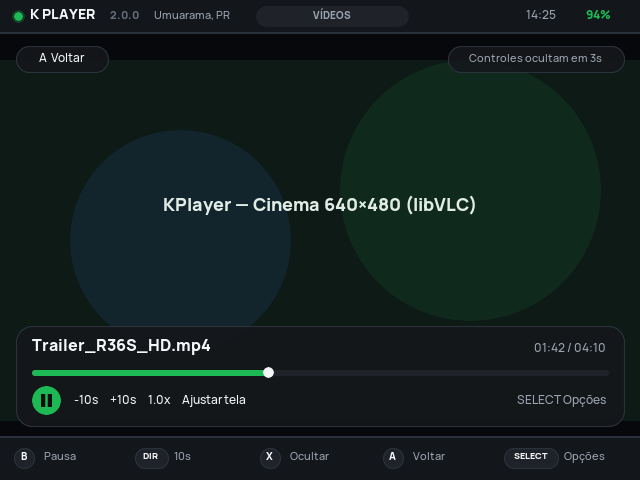 |
| **Settings & 7 Color Themes** | **Official dArkOS / EmulationStation Port Cover** |
| 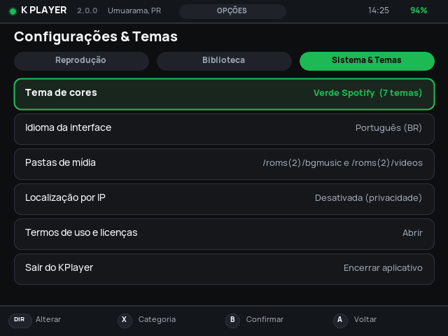 | 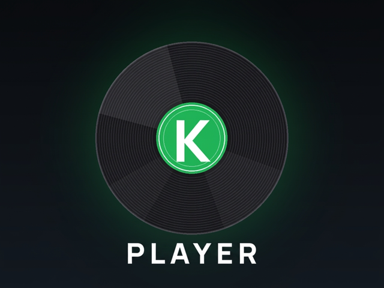 |

---

## Installation on R36S (dArkOS / PortMaster)

1. Download **`KPlayer-v2.0.2-R36S.zip`** from **[Releases](../../releases)**. *(Do not install the GitHub source archive.)*
2. Extract it and copy these files to `/roms/ports/` (or `/roms2/ports/` on SD2):
   - `KPlayer.sh`
   - `kplayer/` directory
   - `images/KPlayer-image.png` *(EmulationStation cover art)*
   - `gamelist.xml` *(if you don't already have one in `ports/`; if you have other ports, paste the `<game>...</game>` block from `kplayer/KPlayer-metadata.xml` into your existing `gamelist.xml`)*.
3. Add your media to the dedicated folders:

| Media Type | SD1 Path | SD2 Path | Recognized Formats |
| :--- | :--- | :--- | :--- |
| **Music (+ `.lrc`)** | `/roms/bgmusic` | `/roms2/bgmusic` | MP3, FLAC, OGG, WAV, M4A, AAC, OPUS |
| **Videos** | `/roms/videos` | `/roms2/videos` | MP4, MKV, AVI, MOV, WEBM |
| **User Radio** | `ports/kplayer/radios_usuario/` | — | `.pls`, `.m3u`, `.m3u8`, `.asx` |
| **User IPTV** | `ports/kplayer/iptv_usuario/` | — | `.m3u`, `.m3u8`, `.txt` (or URL via on-screen keyboard) |

4. Refresh the Ports list in EmulationStation and launch **Ports → KPlayer v2.0.2**.

> **Requirements:** ARM64 R36S running dArkOS with PortMaster, SDL2, ALSA, and compatible VLC plugins in `/usr/lib/aarch64-linux-gnu/vlc/plugins`. Online Radio, IPTV, and Placar da Bola require internet access. See [docs/INSTALL.md](docs/INSTALL.md) for full details.

---

## Controls

| Button | Action |
| :---: | :--- |
| **D-pad** | Navigate menus, switch tabs, pick language/theme, or seek ±10s |
| **B** | Confirm / Open / Play / Match details |
| **A** | Back / Cancel |
| **X** | Switch Queue/Folder in Music · Filter in Football/IPTV · Favorite Radio · Hide Video OSD |
| **Y** | Lyrics in Music · Refresh data (Radio / IPTV / Football / Library) · Terms on Welcome |
| **L1 / R1** | Previous / next track, video, or radio station |
| **START** | Pause / Resume playback |
| **SELECT** | Open / Close Settings |

Use the console's physical buttons for volume. See [docs/CONTROLS.md](docs/CONTROLS.md) for the complete screen-by-screen control map.

---

## Transparency, Open Sources & Terms of Use

- **Origin of IPTV & Online Radio data:** All IPTV and Online Radio listings and metadata displayed in KPlayer are obtained from **public internet aggregators or open sources** (such as the open **Radio-Browser** directory and public web catalogs). KPlayer acts strictly as a **media player** and **does not host, store, or broadcast any media content**.
- **In-app notice before entering streaming features:** Before entering **Online Radio** or **IPTV**, KPlayer presents a **Transparency Notice screen** clearly informing users of the public origin of the listings and providing direct access to the full Terms.
- **Your right to use your own link:** With full transparency toward the user, you always have the right and freedom to add your own playlists and links — either by typing `.m3u`/`.m3u8` URLs via the **on-screen virtual keyboard**, dropping files into `ports/kplayer/iptv_usuario/` (IPTV), or placing stations in `ports/kplayer/radios_usuario/` (Radio).
- Read the complete terms in **[TERMS.md](TERMS.md)** (also accessible inside the app under **Terms of use**).

---

## Build, Tests & Licenses

- **Build & Packaging:** See [docs/BUILD.md](docs/BUILD.md) and [PUBLICAR_NO_GITHUB.md](PUBLICAR_NO_GITHUB.md).
- **License:** Original KPlayer interface code is licensed under **GPL-2.0-or-later** ([LICENSE](LICENSE)). VLC/libVLC, SDL2, stb, and bundled fonts retain their respective licenses in [THIRD_PARTY.md](THIRD_PARTY.md) and `ports/kplayer/licencas/`.
- KPlayer is an independent project and is not affiliated with or endorsed by VideoLAN, PortMaster, or SofaScore.
