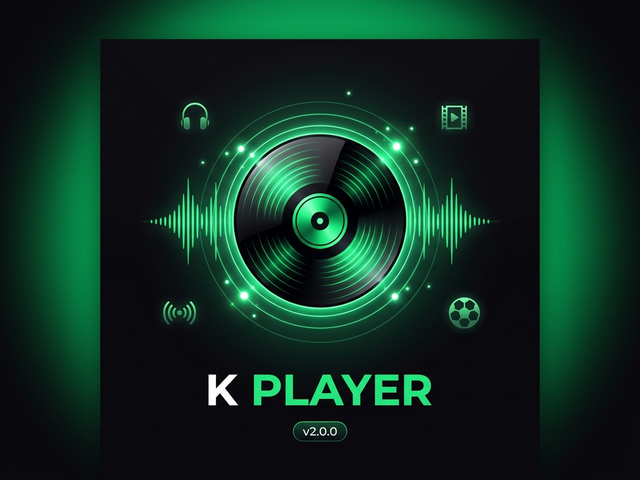

  

<h1 align="center">KPlayer v2.0.0</h1>

  <strong>Central de mídia portátil para R36S (dArkOS / PortMaster)</strong> 
  Músicas com letras sincronizadas (.LRC) · Vídeos · Rádio Online · IPTV · <strong>Placar da Bola</strong>

  <a href="README.md">English</a> ·
  <a href="docs/INSTALL.md">Instalação</a> ·
  <a href="docs/CONTROLS.md">Controles</a> ·
  <a href="docs/MEDIA.md">Mídias e Letras</a> ·
  <a href="CHANGELOG.md">Changelog</a> ·
  <a href="releases/RELEASE_NOTES.md">Notas da Release v2.0.0</a> ·
  <a href="THIRD_PARTY.md">Licenças</a>

---

## Novidades da v2.0.0

- **Tela de Boot Animada (Splash Screen):** toda vez que o KPlayer liga, uma tela animada com vinil giratório, anéis de sonar, faíscas orbitais, equalizador de 28 barras e barra de progresso pré-carrega suas mídias, rádios, IPTV e jogos do Placar da Bola de uma só vez — deixando a navegação interna instantânea e sem travamentos.
- **Tela de Boas-Vindas Slim e Animada:** design enxuto e moderno no mesmo visual do boot, com seletor unificado de idioma (**Português / English / Español**) e **seletor de cores do tema em bolinhas** (7 temas ao vivo), sem botões gigantes nem barra inferior poluída.
- **Placar da Bola (estilo SofaScore):** acompanhe jogos ao vivo, encerrados e futuros do **Brasileirão, Libertadores, Champions League, Premier League** e mais, com filtros (`Todos`, `Ao vivo`, `Brasil`, `Europa`) e tela de detalhes completa com **Estatísticas comparativas**, **Eventos minuto a minuto** e **Escalações**.
- **Player de Música Revisado:** barra central de reprodução perfeitamente centralizada e simétrica (anterior / play-pause / próxima + barra de progresso alinhada) com ícones nítidos, capa/vinil, metadados técnicos (FLAC/MP3, kHz, kbps) e painel alternável de **Letras sincronizadas (.LRC)**, **Fila** e **Pasta**.
- **Pastas Dedicadas (carregamento ultrarrápido):** sem varrer o cartão SD inteiro nem passar por ROMs/BIOS/saves. O KPlayer indexa exclusivamente:
  - **Músicas:** `/roms/bgmusic` (SD1) e `/roms2/bgmusic` (SD2)
  - **Vídeos:** `/roms/videos` (SD1) e `/roms2/videos` (SD2)
- **Capa do Port e Metadados XML para dArkOS / EmulationStation:** o pacote `KPlayer-v2.0.0-R36S.zip` já inclui a capa oficial 640×480 (`images/KPlayer-image.png`), `gamelist.xml` pronto para uso e `kplayer/KPlayer-metadata.xml` para mesclar com seus outros ports.

---

## Capturas de Tela (640 × 480 — R36S)

| Tela de Boot Animada | Boas-Vindas Slim (Idioma + Cores) |
| :---: | :---: |
|  |  |
| **Dashboard Principal** | **Player de Música & Letras (.LRC)** |
|  |  |
| **Placar da Bola — Jogos ao Vivo** | **Placar da Bola — Estatísticas da Partida** |
|  |  |
| **Rádio Online** | **IPTV Ao Vivo (Brasil / Mundo / Local)** |
|  |  |
| **Pastas Dedicadas (SD1 / SD2)** | **Player de Vídeo (libVLC)** |
|  |  |
| **Configurações & 7 Temas** | **Capa Oficial do Port (dArkOS / EmulationStation)** |
|  |  |

---

## Instalação no R36S (dArkOS / PortMaster)

1. Baixe **`KPlayer-v2.0.0-R36S.zip`** na aba **[Releases](../../releases)**. *(Não use o ZIP de código-fonte do GitHub como instalador.)*
2. Extraia o arquivo e copie para `/roms/ports/` (ou `/roms2/ports/` no SD2):
   - `KPlayer.sh`
   - pasta `kplayer/`
   - `images/KPlayer-image.png` *(capa do port no EmulationStation)*
   - `gamelist.xml` *(se ainda não tiver um em `ports/`; caso já possua outros ports, copie apenas o bloco `<game>...</game>` de `kplayer/KPlayer-metadata.xml` para dentro do seu `gamelist.xml` existente)*.
3. Coloque suas mídias nas pastas dedicadas:

| Tipo de Mídia | Cartão SD1 | Cartão SD2 | Formatos reconhecidos |
| :--- | :--- | :--- | :--- |
| **Músicas (+ `.lrc`)** | `/roms/bgmusic` | `/roms2/bgmusic` | MP3, FLAC, OGG, WAV, M4A, AAC, OPUS |
| **Vídeos** | `/roms/videos` | `/roms2/videos` | MP4, MKV, AVI, MOV, WEBM |
| **Rádios pessoais** | `ports/kplayer/radios_usuario/` | — | `.pls`, `.m3u`, `.m3u8`, `.asx` |
| **Listas IPTV locais** | `ports/kplayer/iptv/` | — | `.m3u`, `.m3u8` |

4. Reinicie o EmulationStation (ou atualize a lista de jogos) e abra **Ports → KPlayer v2.0.0**.

> **Requisitos:** R36S ARM64 com dArkOS e PortMaster, SDL2, ALSA e plugins VLC compatíveis em `/usr/lib/aarch64-linux-gnu/vlc/plugins`. Rádio Online, IPTV, Placar da Bola e atualizações exigem conexão com a internet. Veja o guia completo em [docs/INSTALL.md](docs/INSTALL.md).

---

## Controles Principais

| Botão | Ação |
| :---: | :--- |
| **Direcional** | Navegar menus, alternar abas, mudar idioma/tema ou avançar ±10s |
| **B** | Confirmar / Abrir / Tocar / Detalhes da partida |
| **A** | Voltar / Cancelar |
| **X** | Alternar Fila/Pasta na música · Trocar filtro no Placar/IPTV · Favoritar rádio · Ocultar OSD no vídeo |
| **Y** | Letras na música · Atualizar dados (Rádio / IPTV / Placar / Biblioteca) · Termos nas Boas-Vindas |
| **L1 / R1** | Faixa, vídeo ou estação anterior / seguinte |
| **START** | Pausar / Retomar reprodução |
| **SELECT** | Abrir / Fechar Opções |

O volume é controlado diretamente pelos botões físicos do console. Confira o mapa completo por tela em [docs/CONTROLS.md](docs/CONTROLS.md).

---

## Recursos Técnicos

- **Motor nativo em C + SDL2 + libVLC** compilado especificamente para `aarch64-linux-gnu` em 640×480.
- **7 temas de cores** com troca instantânea nas Boas-Vindas ou em Opções: *Verde Spotify*, *Noite Azul*, *Claro Menta*, *Claro Quente*, *Vermelho Neon*, *Roxo Synth* e *Âmbar Retrô*.
- **3 idiomas integrados:** Português (BR), English e Español.
- **Metadados ID3 locais:** lê título, artista, álbum, capa embutida (JPEG/PNG) e letras sincronizadas/embutidas (`.lrc` / USLT) sem depender de internet.
- **Fila, Repetição, Aleatório, Favoritas, Timer de sono, Retomar mídia e Equalizador libVLC.**
- **Atualizador experimental integrado:** verifica novas releases públicas no GitHub com validação de integridade SHA-256 e confirmação do usuário.

---

## Compilação, Testes e Licenças

- **Compilar binário ARM64 e gerar ZIP instalável:** consulte [docs/BUILD.md](docs/BUILD.md) e [PUBLICAR_NO_GITHUB.md](PUBLICAR_NO_GITHUB.md).
- **Licença:** o código original do KPlayer é distribuído sob **GPL-2.0-or-later** ([LICENSE](LICENSE)). VLC/libVLC, SDL2, stb e fontes seguem suas respectivas licenças listadas em [THIRD_PARTY.md](THIRD_PARTY.md) e `ports/kplayer/licencas/`.
- KPlayer é um projeto independente, sem afiliação oficial com VideoLAN, PortMaster ou SofaScore.
