

  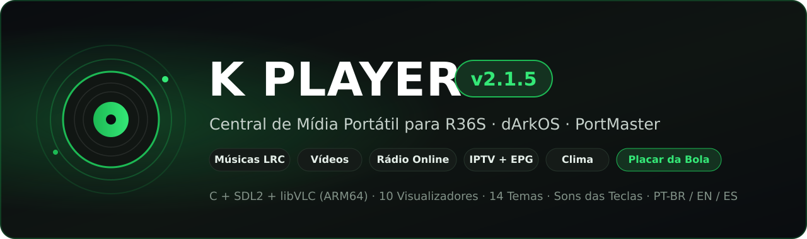

<h1 align="center">KPlayer v2.0.2</h1>

  <strong>Central de mídia portátil para R36S (Principal — dArkOS / PortMaster) &amp; Android (Edição Retrato)</strong> 
  Músicas com letras sincronizadas (.LRC) · Vídeos · Rádio Online · IPTV · <strong>Placar da Bola</strong>

  <a href="README.md">English</a> ·
  <a href="docs/INSTALL.md">Instalação (R36S)</a> ·
  <a href="docs/ANDROID.md">Edição Android (Retrato)</a> ·
  <a href="docs/CONTROLS.md">Controles</a> ·
  <a href="docs/MEDIA.md">Mídias e Letras</a> ·
  <a href="TERMS.md">Termos e Transparência</a> ·
  <a href="CHANGELOG.md">Changelog</a> ·
  <a href="releases/RELEASE_NOTES.md">Notas da Release v2.0.2</a> ·
  <a href="THIRD_PARTY.md">Licenças</a>

---

## Novidades da v2.0.2

- **Tela de Aviso de Transparência e Termos Atualizados:** antes de entrar em **Rádio Online** ou **IPTV**, o player exibe uma tela clara informando que todos os dados vêm de agregadores públicos da internet ou fontes abertas, que o KPlayer não hospeda conteúdo e que você tem total direito de inserir seus próprios links e playlists.
- **Tela de Boot Animada (Splash Screen):** toda vez que o KPlayer liga, uma tela animada com vinil giratório, anéis de sonar, faíscas orbitais, equalizador de 28 barras e barra de progresso pré-carrega suas mídias, rádios, IPTV e jogos do Placar da Bola de uma só vez — deixando a navegação interna instantânea e sem travamentos.
- **Tela de Boas-Vindas Slim e Animada:** design enxuto e moderno no mesmo visual do boot, com seletor unificado de idioma (**Português / English / Español**) e **seletor de cores do tema em bolinhas** (7 temas ao vivo), sem botões gigantes nem barra inferior poluída.
- **Placar da Bola (estilo SofaScore):** acompanhe jogos ao vivo, encerrados e futuros do **Brasileirão, Libertadores, Champions League, Premier League** e mais, com filtros (`Todos`, `Ao vivo`, `Brasil`, `Europa`) e tela de detalhes completa com **Estatísticas comparativas**, **Eventos minuto a minuto** e **Escalações**.
- **Player de Música Revisado:** barra central de reprodução perfeitamente centralizada e simétrica (anterior / play-pause / próxima + barra de progresso alinhada) com ícones nítidos, capa/vinil, metadados técnicos (FLAC/MP3, kHz, kbps) e painel alternável de **Letras sincronizadas (.LRC)**, **Fila** e **Pasta**.
- **Pastas Dedicadas (carregamento ultrarrápido):** sem varrer o cartão SD inteiro nem passar por ROMs/BIOS/saves. O KPlayer indexa exclusivamente:
  - **Músicas:** `/roms/bgmusic` (SD1) e `/roms2/bgmusic` (SD2)
  - **Vídeos:** `/roms/videos` (SD1) e `/roms2/videos` (SD2)
- **IPTV desbloqueado e categorizado (Canais · Filmes · Séries · Usuário):** sem limite de canais/filmes/episódios e com carregamento sob demanda categoria por categoria — **245 Canais de TV** em 12 categorias (`catalogo.txt` + reservas em `https://canais-saimo.pages.dev/`), **Filmes** (~30.000+ filmes por destaques, animes/kids, gêneros TMDB e A–Z), **Séries** (~13.000+ séries com seleção completa de temporadas e todos os episódios de `https://filmes-saimo.pages.dev/`) e **IPTV do Usuário** (teclado virtual para digitar URLs `.m3u`/`.m3u8` ou leitura automática de arquivos na pasta `ports/kplayer/iptv_usuario/`).
- **Capa do Port e Metadados XML para dArkOS / EmulationStation:** o pacote `KPlayer-v2.0.2-R36S.zip` já inclui a capa oficial 640×480 (`images/KPlayer-image.png`), `gamelist.xml` pronto para uso e `kplayer/KPlayer-metadata.xml` para mesclar com seus outros ports.
- **Nova Edição Android (Modo Retrato — Lado a Lado):** aplicativo Android nativo em **Kotlin + Jetpack Compose + Material 3 + Media3 (ExoPlayer)** na pasta `android/`, mantendo a edição **R36S como principal** e trazendo um player de música e entretenimento moderno em modo retrato com **todas as funções do KPlayer v2.0.2**, sem as limitações de tela 640×480 ou ausência de toque do console. Veja o guia completo em [docs/ANDROID.md](docs/ANDROID.md).

---

## Capturas de Tela (640 × 480 — R36S)

| Tela de Boot Animada | Boas-Vindas Slim (Idioma + Cores) |
| :---: | :---: |
| 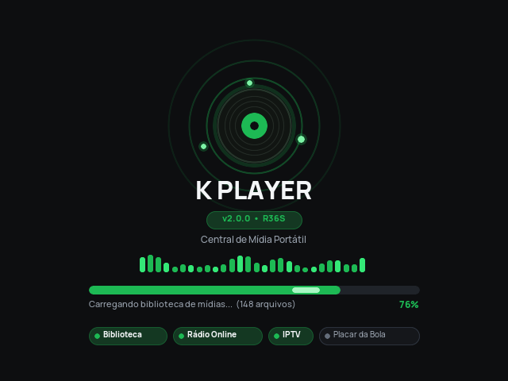 | 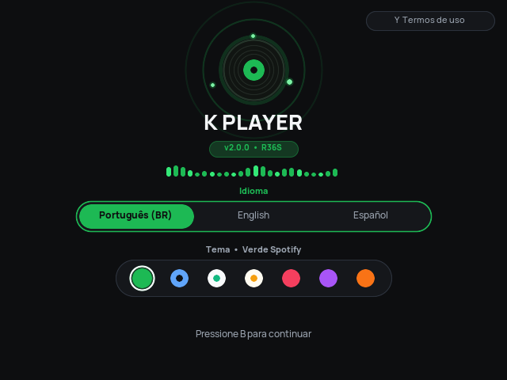 |
| **Dashboard Principal** | **Player de Música & Letras (.LRC)** |
| 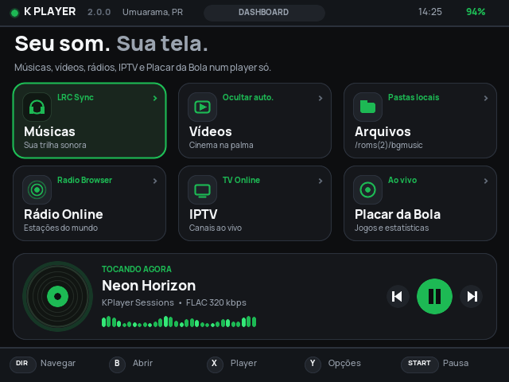 | 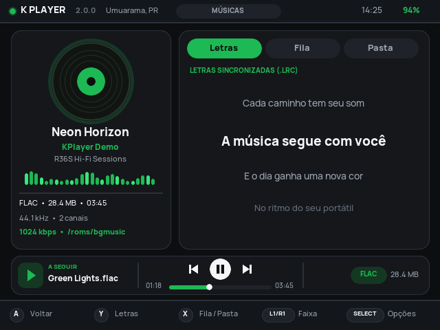 |
| **Placar da Bola — Jogos ao Vivo** | **Placar da Bola — Estatísticas da Partida** |
| 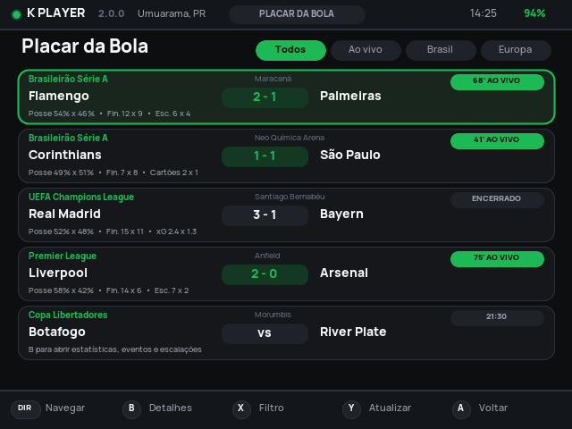 | 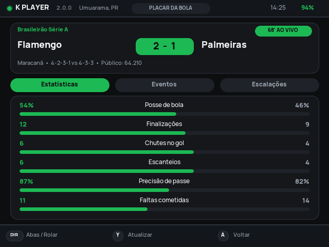 |
| **Rádio Online** | **IPTV (Canais · Filmes · Séries · Usuário)** |
| 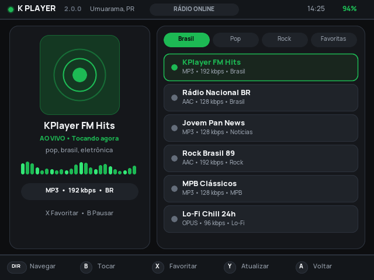 | 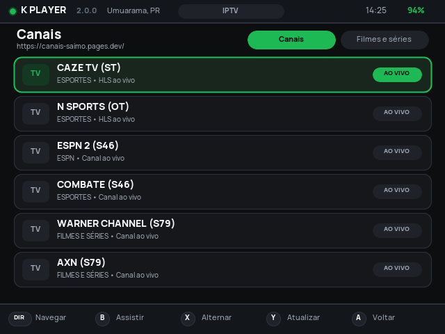 |
| **Pastas Dedicadas (SD1 / SD2)** | **Player de Vídeo (libVLC)** |
| 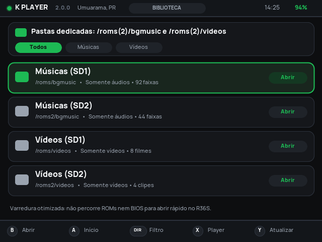 | 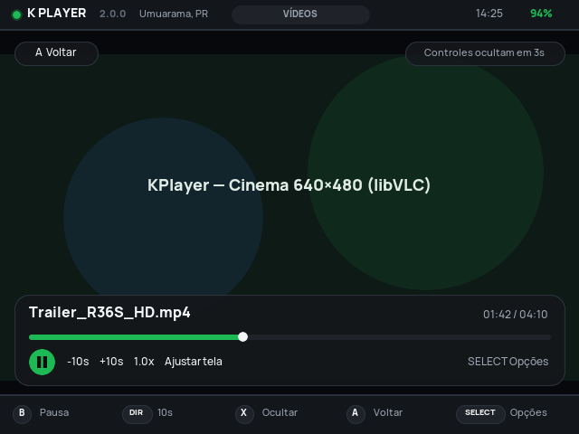 |
| **Configurações & 7 Temas** | **Capa Oficial do Port (dArkOS / EmulationStation)** |
| 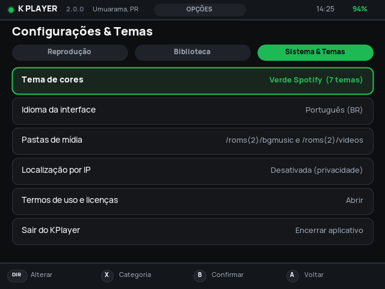 |  |

---

## Instalação no R36S (dArkOS / PortMaster)

1. Baixe **`KPlayer-v2.0.2-R36S.zip`** na aba **[Releases](../../releases)**. *(Não use o ZIP de código-fonte do GitHub como instalador.)*
2. Extraia o arquivo e copie para `/roms/ports/` (ou `/roms2/ports/` no SD2):
   - `KPlayer.sh`
   - pasta `kplayer/`
   - `images/KPlayer-image.png` *(capa do port no EmulationStation)*
   - `gamelist.xml` *(se ainda não tiver um em `ports/`; caso já possua outros ports, copie apenas o bloco `<game>...</game>` de `kplayer/KPlayer-metadata.xml` para dentro do seu `gamelist.xml` existente)*.
3. Coloque suas mídias nas pastas dedicadas:

| Tipo de Mídia | Cartão SD1 | Cartão SD2 | Formatos reconhecidos |
| :--- | :--- | :--- | :--- |
| **Músicas (+ `.lrc`)** | `/roms/bgmusic` | `/roms2/bgmusic` | MP3, FLAC, OGG, WAV, M4A, AAC, OPUS |
| **Vídeos** | `/roms/videos` | `/roms2/videos` | MP4, MKV, AVI, MOV, WEBM |
| **Rádios pessoais** | `ports/kplayer/radios_usuario/` | — | `.pls`, `.m3u`, `.m3u8`, `.asx` |
| **IPTV do Usuário** | `ports/kplayer/iptv_usuario/` | — | `.m3u`, `.m3u8`, `.txt` (ou link pelo teclado virtual) |

4. Reinicie o EmulationStation (ou atualize a lista de jogos) e abra **Ports → KPlayer v2.0.2**.

> **Requisitos (R36S):** R36S ARM64 com dArkOS e PortMaster, SDL2, ALSA e plugins VLC compatíveis em `/usr/lib/aarch64-linux-gnu/vlc/plugins`. Rádio Online, IPTV e Placar da Bola exigem conexão com a internet. Veja o guia completo em [docs/INSTALL.md](docs/INSTALL.md).

---

## Edição Android v2.0.2 (Modo Retrato — Lado a Lado)

Além da edição principal de **R36S**, o repositório mantém lado a lado o **KPlayer Android** (`android/`), um aplicativo nativo em **modo retrato** projetado para smartphones Android 8.0+ (API 26–35) com visual moderno e paridade total de recursos:

- **Player de Música Moderno:** Mini-Player flutuante persistente, tela cheia **Now Playing**, capa em alta resolução, **Letras sincronizadas (`.LRC`) com toque para pular**, Fila, Favoritas, velocidade de reprodução (`0.75x–1.5x`), Timer de Sono e **Equalizador de hardware (5 bandas / 6 presets)**.
- **Vídeos, IPTV Desbloqueado, Rádio Online e Placar da Bola:** todas as mesmas fontes e recursos do R36S — incluindo os **245 canais de TV** em 12 categorias, **Filmes e Séries** completos sob demanda, **IPTV do Usuário** (teclado nativo + importação `.m3u`), **Rádio Online (Radio-Browser)**, **Placar da Bola** (Estatísticas, Eventos e Escalações), **Tela de Aviso de Transparência**, **7 temas** e **3 idiomas**.
- **Instalação:** baixe **`KPlayer-v2.0.2-Android.apk`** na aba **[Releases](../../releases)** (compilado automaticamente junto com o ZIP do R36S pelo GitHub Actions).

| Edição | Plataforma | Motor | Empacotamento |
| :--- | :--- | :--- | :--- |
| **KPlayer R36S (Principal)** | R36S / dArkOS / PortMaster (640×480, D-Pad) | C + SDL2 + libVLC (ARM64) | `KPlayer-v2.0.2-R36S.zip` |
| **KPlayer Android (Lado a Lado)** | Android 8.0+ (Modo Retrato, Toque) | Kotlin + Jetpack Compose + Media3 | `KPlayer-v2.0.2-Android.apk` |

Veja a documentação completa, permissões e instruções de compilação em **[docs/ANDROID.md](docs/ANDROID.md)**.

---

## Controles Principais

| Botão | Ação |
| :---: | :--- |
| **Direcional** | Navegar menus, alternar abas, mudar idioma/tema ou avançar ±10s |
| **B** | Confirmar / Abrir / Tocar / Detalhes da partida |
| **A** | Voltar / Cancelar |
| **X** | Alternar Fila/Pasta na música · Trocar filtro no Placar/IPTV · Favoritar rádio · Ocultar OSD no vídeo |
| **Y** | Letras na música · Atualizar dados (Rádio / IPTV / Placar / Biblioteca) · Termos nas Boas-Vindas |
| **L1 / R1** | Faixa, vídeo ou estação anterior / seguinte |
| **START** | Pausar / Retomar reprodução |
| **SELECT** | Abrir / Fechar Opções |

O volume é controlado diretamente pelos botões físicos do console. Confira o mapa completo por tela em [docs/CONTROLS.md](docs/CONTROLS.md).

---

## Recursos Técnicos

- **Motor nativo em C + SDL2 + libVLC** compilado especificamente para `aarch64-linux-gnu` em 640×480.
- **7 temas de cores** com troca instantânea nas Boas-Vindas ou em Opções: *Verde Spotify*, *Noite Azul*, *Claro Menta*, *Claro Quente*, *Vermelho Neon*, *Roxo Synth* e *Âmbar Retrô*.
- **3 idiomas integrados:** Português (BR), English e Español.
- **Metadados ID3 locais:** lê título, artista, álbum, capa embutida (JPEG/PNG) e letras sincronizadas/embutidas (`.lrc` / USLT) sem depender de internet.
- **Fila, Repetição, Aleatório, Favoritas, Timer de sono, Retomar mídia e Equalizador libVLC.**
- **IPTV ilimitado e por categorias:** `Canais` (`https://canais-saimo.pages.dev/`), `Filmes` e `Séries` completos (`https://filmes-saimo.pages.dev/` com todas as temporadas/episódios sob demanda) + `IPTV do Usuário` via teclado virtual ou pasta `ports/kplayer/iptv_usuario/`, com reprodução direta via libVLC.

---

## Transparência, Fontes Abertas e Termos de Uso

- **Origem dos dados (IPTV e Rádio Online):** todos os dados, listas e metadados de IPTV e Rádio Online exibidos no KPlayer foram retirados de **agregadores públicos da internet ou de fontes abertas** (como o diretório aberto **Radio-Browser** e catálogos web públicos). O KPlayer atua estritamente como **reprodutor de mídia** e **não hospeda, armazena nem transmite conteúdo próprio**.
- **Aviso antes de entrar no player:** antes de acessar as funções de **Rádio Online** ou **IPTV**, o KPlayer apresenta uma **Tela de Aviso de Transparência** deixando clara a origem pública dos dados e o acesso aos Termos completos.
- **Direito de colocar seu próprio link:** demonstrando total transparência com o usuário, você tem o direito e a liberdade de usar suas próprias listas e links a qualquer momento — seja digitando URLs `.m3u`/`.m3u8` pelo **teclado virtual na tela**, copiando arquivos em `ports/kplayer/iptv_usuario/` (IPTV) ou em `ports/kplayer/radios_usuario/` (Rádio).
- Leia os termos completos em **[TERMS.md](TERMS.md)** (também disponíveis dentro do aplicativo em **Termos de uso**).

---

## Compilação, Testes e Licenças

- **Compilar binário ARM64 e gerar ZIP instalável:** consulte [docs/BUILD.md](docs/BUILD.md) e [PUBLICAR_NO_GITHUB.md](PUBLICAR_NO_GITHUB.md).
- **Licença:** o código original do KPlayer é distribuído sob **GPL-2.0-or-later** ([LICENSE](LICENSE)). VLC/libVLC, SDL2, stb e fontes seguem suas respectivas licenças listadas em [THIRD_PARTY.md](THIRD_PARTY.md) e `ports/kplayer/licencas/`.
- KPlayer é um projeto independente, sem afiliação oficial com VideoLAN, PortMaster ou SofaScore.
